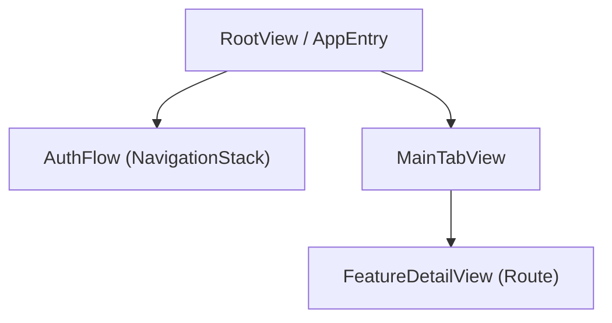

# 🧭 Mapa Global de Rutas y Puntos de Entrada

> Pertenece a: `overview/architecture/routes_map.md`  
> Referenciado desde: [`overview/architecture.md`](../architecture.md)

## 1. Diagrama Sintético de Enrutamiento

## 2. Definición de Rutas Registradas

| Ruta | Vista / Route | Guard / Parámetros |
|---|---|---|
| `/` | Root / Entry | Inicialización |
| `/main` | Principal | Auth / Session Guard |
